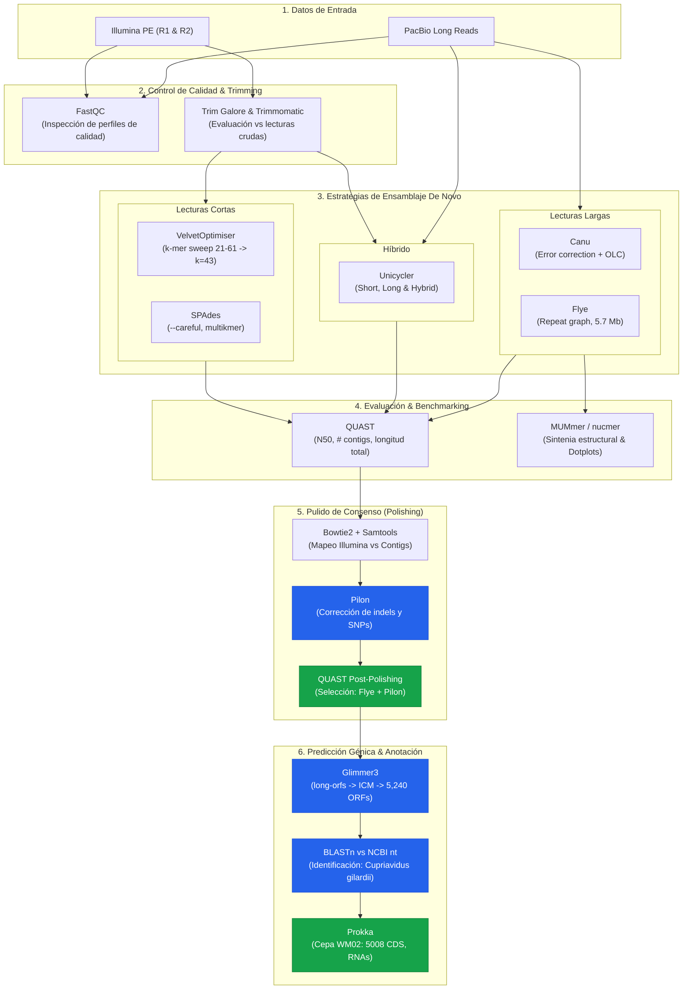

# *De Novo* Bacterial Genome Assembly, Benchmarking & Functional Annotation
### Reconstrucción Genómica de *Cupriavidus gilardii* WM02 mediante Enfoques Híbridos (Illumina + PacBio)

##  Resumen del Proyecto

Este repositorio contiene el flujo de trabajo bioinformático completo para el ensamblaje *de novo*, control de calidad, benchmarking comparativo, pulido de consenso y anotación funcional del genoma de una bacteria aislada a partir de lecturas cortas (**Illumina Paired-End**) y lecturas largas (**PacBio**).

El proyecto evaluó y comparó sistemáticamente múltiples algoritmos de ensamblaje (grafos de De Bruijn, enfoques híbridos y Overlap-Layout-Consensus / grafos de repetición) para seleccionar la reconstrucción de mayor continuidad y precisión:
1. **Ensambladores de lecturas cortas**: Velvet (con optimización de k-meros mediante VelvetOptimiser) y SPAdes.
2. **Ensambladores híbridos**: Unicycler (modos long, short e hybrid).
3. **Ensambladores de lecturas largas**: Canu y Flye.
4. **Pulido genómico**: Pilon (alineando lecturas Illumina de alta calidad sobre los ensambles de lecturas largas).
5. **Predicción génica y anotación funcional**: Glimmer3, BLASTn (base `nt` de NCBI) y Prokka.

La mejor reconstrucción genómica se obtuvo mediante **Flye corregido con Pilon**, logrando un genoma altamente continuo de **5.67 Mb** en solo **3 contigs** (N50 de **3.54 Mb**). La identificación taxonómica determinó con alta confianza la especie ***Cupriavidus gilardii* WM02**, identificándose **5,008 secuencias codificantes (CDS)**, 12 ARNr y 65 ARNt.

---

##  Autores y Créditos

Proyecto desarrollado en colaboración para la materia de Genómica / Ciencias Genómicas (Servidor de Cómputo *Chaac*):

- **Andrea Villarruel García** - *Co-desarrollo del pipeline, control de calidad, ensambles, evaluación y anotación funcional*
- **Addiel Antonio Renteral Platas** - *Co-desarrollo del pipeline, optimización de parámetros, alineamientos y benchmarking*

---

## Flujo de Trabajo (Workflow)



---

## 📊 Resultados Clave & Benchmarking

### 1. Comparativa de Ensamblajes (QUAST)

Alineamiento y métricas calculadas sobre contigs $\ge 200\text{ bp}$:

| Estrategia / Ensamblador | Lecturas Empleadas | # Contigs | Mayor Contig (pb) | Longitud Total (pb) | N50 (pb) | % GC | L50 |
| :--- | :--- | :---: | :---: | :---: | :---: | :---: | :---: |
| **Velvet** ($k=43$) | Illumina PE | 814 | 90,352 | 5,502,284 | 15,627 | ~67.6% | - |
| **SPAdes** | Illumina PE | ~89 | 249,362 | 5,466,457 | 103,614 | 67.67% | 20 |
| **Unicycler (Long)** | PacBio | 10 | 2,091,254 | 5,772,339 | 1,798,739 | 67.48% | 2 |
| **Unicycler (Hybrid)** | Illumina + PacBio | 6 | 2,187,228 | 5,582,936 | 952,931 | 67.61% | 2 |
| **Canu** | PacBio | **1** | **5,641,814** | **5,641,814** | **5,641,814** | 67.59% | **1** |
| **Flye** | PacBio | 3 | 3,540,261 | 5,671,425 | 3,540,261 | 67.56% | 1 |
| **Flye + Pilon (Final)** | **Híbrido (Flye + Illu)** | **3** | **3,540,269** | **5,671,434** | **3,540,269** | **67.56%** | **1** |

> **Nota Biológica y Metodológica:**
> Aunque Canu resolvió el genoma en un único contig, Flye presentó mayor concordancia en la longitud total esperada (~5.67 Mb) y una tasa menor de discordancias estructurales. Tras el pulido con **Pilon** utilizando lecturas Illumina de alta cobertura, Flye alcanzó la máxima precisión a nivel nucleotídico, siendo seleccionado para la anotación funcional.

### 2. Identificación Taxonómica y Anotación Funcional

- **Identificación taxonómica (BLASTn)**: El alineamiento de los genes predichos por Glimmer3 contra la base de datos `nt` del NCBI arrojó como mejor coincidencia el identificador `CP104386.1` correspondiente a ***Cupriavidus gilardii*** (identidad nucleotídica $>99\%$).
- **Anotación con Prokka (`CP10`)**:
  - **Organismo**: *Cupriavidus gilardii* WM02
  - **Tamaño total**: 5,671,434 pb
  - **CDS (Secuencias codificantes predichas)**: 5,008
  - **ARNr**: 12
  - **ARNt**: 65
  - **tmRNA**: 1

---

## 📂 Estructura del Repositorio

El repositorio está organizado siguiendo las mejores prácticas para código científico reproducible en bioinformática:

```text
.
├── .gitignore                   # Exclusión de archivos binarios/masivos (>100MB, FASTQ, BAM, SAM)
├── LICENSE                      # Licencia de código abierto MIT
├── README.md                    # Documentación principal del proyecto
├── environment.yml              # Definición del entorno Conda con todas las dependencias
│
├── docs/                        # Documentación técnica extendida
│   ├── reporte_completo.md      # Reporte metodológico exhaustivo con comandos y figuras
│   └── ProyectoEnsamble_PlatasAddiel_VillarruelAndrea.html # Reporte interactivo original
│
├── scripts/                     # Scripts modulares del pipeline bioinformático
│   ├── run_pipeline.sh          # Script maestro para ejecución secuencial
│   ├── 01_quality_control.sh    # Control de calidad inicial (FastQC)
│   ├── 02_trimming.sh           # Limpieza y filtrado (Trim Galore y Trimmomatic)
│   ├── 03_short_read_assembly.sh# Ensambles con Velvet y SPAdes
│   ├── 04_long_read_assembly.sh # Ensambles con Canu y Flye
│   ├── 05_hybrid_assembly.sh    # Ensambles con Unicycler
│   ├── 06_assembly_evaluation.sh# Benchmarking con QUAST y sintenia con MUMmer
│   ├── 07_polishing_pilon.sh    # Pulido genómico con Bowtie2 + Pilon
│   ├── 08_gene_prediction_glimmer.sh # Predicción génica ab initio con Glimmer3
│   └── 09_functional_annotation.sh   # Identificación (BLASTn) y anotación (Prokka)
│
└── results/                     # Entregables y resúmenes de resultados
    ├── quast/                   # Reportes de evaluación de ensamblajes (HTML, TSV, TXT)
    ├── mummer/                  # Tablas de coordenadas estructurales de alineamiento
    └── annotation/              # Resúmenes de anotación funcional de Prokka y BLASTn
```

---

## 🛠️ Instalación y Requisitos

Todas las dependencias pueden ser instaladas y gestionadas fácilmente a través de [Conda](https://docs.conda.io/en/latest/) o [Mamba](https://mamba.readthedocs.io/):

```bash
# Clonar el repositorio
git clone https://github.com/<tu-usuario>/<nombre-del-repo>.git
cd <nombre-del-repo>

# Crear el entorno con todas las herramientas requeridas
conda env create -f environment.yml

# Activar el entorno
conda activate bacterial_genome_assembly
```

### Principales herramientas incluidas:
- **QC & Trimming**: `FastQC` (v0.11+), `Trim Galore` (v0.6+), `Trimmomatic` (v0.39+)
- **Ensambladores**: `Velvet` (v1.2+), `SPAdes` (v3.15+), `Unicycler` (v0.5+), `Canu` (v2.2+), `Flye` (v2.9+)
- **Evaluación**: `QUAST` (v5.2+), `MUMmer` (v3.23+)
- **Mapeo & Pulido**: `Bowtie2` (v2.5+), `Samtools` (v1.17+), `Pilon` (v1.24+)
- **Anotación**: `Glimmer3` (v3.02+), `BLAST+` (v2.14+), `Prokka` (v1.14+)

---

## 🚀 Guía de Reproducción

Los scripts en la carpeta `scripts/` están completamente comentados y organizados para ser ejecutados de forma individual o encadenada:

```bash
# Ejecutar todo el pipeline de manera secuencial:
bash scripts/run_pipeline.sh

# O ejecutar un paso específico, por ejemplo el pulido con Pilon:
bash scripts/07_polishing_pilon.sh
```

> **Nota sobre los datos:** Los archivos de secuenciación FASTQ masivos no están incluidos directamente en el repositorio de Git debido a su peso, pero pueden ser referenciados o vinculados simbólicamente en la carpeta `data/`.

---

## 📖 Documentación Detallada

Para una descripción pormenorizada de cada parámetro, decisiones de control de calidad y discusión biológica con capturas y dotplots de sintenia, consulta:
- [Reporte Completo en Markdown](docs/reporte_completo.md)
- [Reporte Interactivo en HTML](docs/ProyectoEnsamble_PlatasAddiel_VillarruelAndrea.html)

---

## 📜 Licencia

Este proyecto está bajo la Licencia [MIT](LICENSE).
